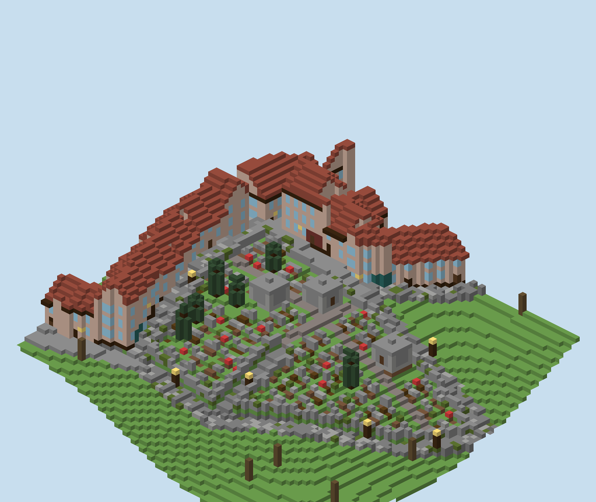
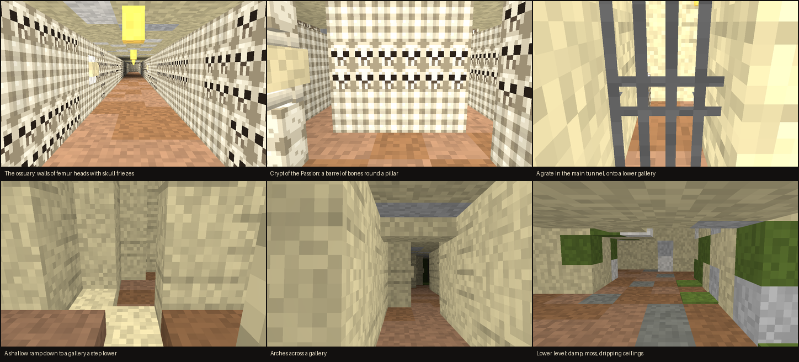
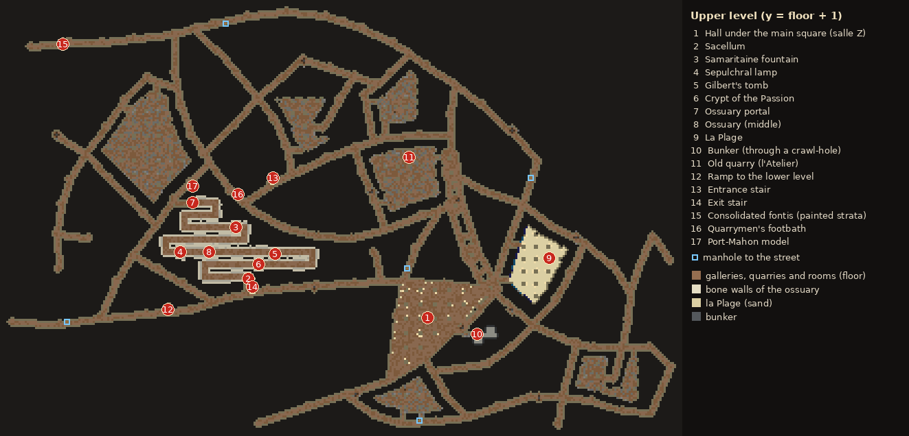
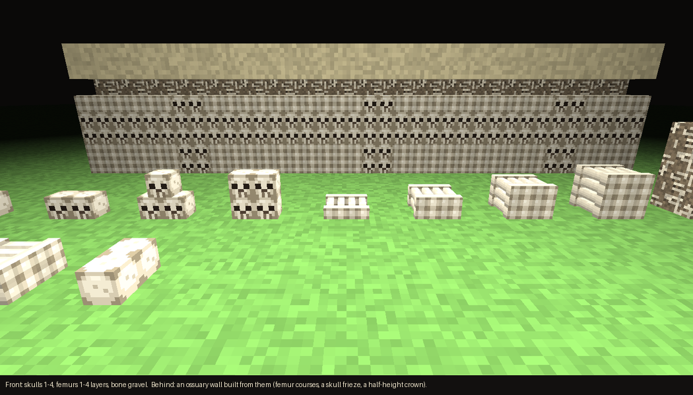

# Emergent City for Minecraft Forge 1.20.1

Run one command and villagers grow a historic-style town out of the terrain around you. It follows the rules in
*Emergent Historic City Generation v1.0*:
- streets, blocks, plazas, centres and monuments come out of the growth simulation;
- the simulation reads the actual ground, water and slopes of your world;
- the houses along the streets are built from **house units**: designs stored as ordinary structure files, which you can
  open, edit and add to with a structure block (see *House units*);
- optionally, **Paris-style catacombs** are dug under the town: galleries under every street, old quarries, an ossuary
  walled with bones, a lower level and hidden rooms (see *Catacombs*).

It comes as **two mods**, built and played together from this folder:
- **Emergent City** (`emergentcity/`): the town, its cemeteries and catacombs, villager mode and evolving towns. It
  works on its own.
- **Emergent City: Plague** (`emergentplague/`): plague mode, an addon that needs the city mod (see *Plague mode*). It
  adds the `plague` option to the city's commands.

## Quick start (no modding experience needed)

This folder is a complete, ready-to-run project. The Forge MDK (the official kit for building Forge mods) is already
included, so you don't need to download anything else by hand. One command builds both mods and opens Minecraft with
them installed. You don't need a Minecraft launcher or a separate Forge install for testing; a Minecraft account is only needed
for the normal launcher (see *Playing it in your normal Minecraft*).

### 1. Install Java 17

Minecraft 1.20.1 mods are built with **Java 17**, and the build tool only runs on 17. Installing it alongside a newer Java
is fine.

- **Mac:** install *Temurin 17* from <https://adoptium.net> (choose version 17, the `.pkg` installer), or, with Homebrew,
  run `brew install --cask temurin@17`. You don't need to change any settings: this project's `gradlew` finds Java 17 by
  itself, even if your default Java is newer.
- **Windows:** install *Temurin 17* from <https://adoptium.net> (the `.msi`). On the installer's *Custom Setup* page,
  turn on **Set JAVA_HOME variable**. If you also have a newer Java, this makes sure Java 17 is the one used.
- **Linux:** install your distribution's OpenJDK 17 package (for example `sudo apt install openjdk-17-jdk`).

### 2. Start Minecraft with the mod

Open a terminal in this folder:
- **Mac:** in Finder, right-click the folder and choose *New Terminal at Folder* (or open Terminal, type `cd `, drag the
  folder into the window and press Return).
- **Windows:** open the folder in File Explorer, click the address bar, type `cmd` and press Enter.

Then run:

| Mac / Linux | Windows |
|---|---|
| `./play.sh` | `gradlew.bat runClient` |

(`./play.sh` runs `./gradlew runClient`; the game folder, with your worlds, settings and logs, is `instance/`.)

The **first run takes 5–15 minutes**: it downloads Minecraft, Forge and the build tools (about 1 GB) and prepares them.
Later runs start in about a minute. The game opens in a new window when it's ready; the terminal keeps printing a log
while it runs. That's normal; leave the terminal open. Closing the game ends the command.

### 3. Make a test world

1. Click **Singleplayer**, then **Create New World**.
2. Set **Game Mode** to *Creative* and **Allow Cheats** to *ON* (the city commands need cheats).
3. Click **More World Options...**, then click **World Type** until it says **City Test (gentle hills, no trees)**. This
   flat-ish, empty landscape is best for a first try; any normal world works too.
4. Click **Create New World** and wait for the world to load.

### 4. Grow a town

1. Press **T** to open the chat box. Type `/emergentcity instant 150` and press **Enter**.
2. Chat shows the three stages: reading the terrain, growing the town and placing blocks. A bar at the top of the screen
   shows progress. A radius-150 town takes under a minute, a little longer where the game first has to generate the land.
3. Look around. In Creative, **double-tap the space bar** to fly, hold **space** to rise and **shift** to sink. **F5**
   switches to an outside view, and **F1** hides the interface for screenshots. For the whole town, raise *Render
   Distance* to 16 or more in *Options → Video Settings*.
4. To remove it again, type `/emergentcity undo`.

Then try:
- `/emergentcity generate 150`: villagers lay out the streets and build the town in front of you (10–20 minutes);
- `/emergentcity instant 200 bricks boulevards`: a brick town with straight avenues;
- `/emergentcity instant 200 freestanding`: monuments that stand in the middle of their squares;
- `/emergentcity instant 150 catacombs`: the town plus catacombs underneath. When it's done, chat lists the entrance
  stair and other sights; **click a coordinate** to put a teleport command in the chat box. Bring torches: only the
  visitor route is lit.

The full list of commands and options is under *Commands* below. Radius goes from 48 to 400 blocks.

### Playing it in your normal Minecraft

To add the mods to a regular game:
1. Run `./play.sh build` (Windows: `gradlew.bat cityJar plagueJar`). The two mod files appear in `jars/` (Windows:
   `build/libs/`): `emergentcity-0.1.0.jar` and `emergentplague-0.1.0.jar`.
2. Install **Forge for Minecraft 1.20.1** with the installer from <https://files.minecraftforge.net> ("Install client").
3. Put the `.jar` files in your Minecraft `mods` folder: the city one alone, or both for the plague (the plague mod
   doesn't load without the city mod). On Mac that's `~/Library/Application Support/minecraft/mods`; on
   Windows it's `%APPDATA%\.minecraft\mods`. Create the folder if it isn't there.
4. In the Minecraft Launcher, pick the *forge 1.20.1* profile and play.

On a Forge server, put the same `.jar` files in the server's `mods` folder. Players need op rights (level 2) for the commands. The city mod adds its own blocks (see *Bone blocks*), so everyone who joins the server needs its `.jar` in their `mods` folder too (and the plague's, which Forge expects on both sides).

### If something goes wrong

| Problem | Fix |
|---|---|
| `Emergent City: Java 17 not found` | Install Java 17 (step 1), then run the command again. |
| `Unsupported class file major version` or *Could not determine java version* | The build is running on the wrong Java. On Windows, set `JAVA_HOME` to the Java 17 folder (reinstall Temurin 17 with *Set JAVA_HOME* turned on) and open a new terminal. |
| `permission denied: ./gradlew` (Mac/Linux) | Run `chmod +x gradlew` once. |
| The first run stops with a download or network error | Check your internet connection and run the same command again; it continues where it stopped. |
| Strange build errors after changing files | Run `./gradlew clean` and then `./play.sh` again. |
| `Unknown option 'plague'` | The plague mod isn't loaded: play with `./play.sh` (both mods), or put both jars in `mods`. |
| `Unknown or incomplete command` in chat | Cheats are off: create the world with *Allow Cheats: ON*, or open it to LAN with cheats on (*Esc → Open to LAN*). |
| The game is slow while a town is placed | Normal for large radii. Try a smaller radius, or `/emergentcity cancel` to stop. |

### What's in this folder

| Path | What it is |
|---|---|
| `emergentcity/` | The city mod. `src/main/java/` is its code (`com/emergentcity/city`, plus the bone blocks in `com/emergentcity/content`); `src/main/resources/` its data files: the house units (`data/emergentcity/structures/units/`), the City Test world type, the bone blocks' textures, models, drops and recipes (`assets/emergentcity/`, `data/emergentcity/`), and its description (`META-INF/mods.toml`). |
| `emergentplague/` | The plague mod: its code (`src/main/java/com/emergentcity/plague`) and description. It plugs into the city mod through the city's addon hooks (`TownMode`, `CityAddon`). |
| `instance/` | The game folder `./play.sh` uses: your test worlds (`instance/saves/`), settings (`instance/options.txt`, `instance/config/emergentcity.properties`) and logs (`instance/logs/`). |
| `play.sh` | Builds both mods and plays (`./play.sh`), runs a server (`./play.sh server`) or makes the two jars (`./play.sh build`). |
| `build.gradle`, `settings.gradle`, `gradle.properties` | Build settings for both mods. `gradle.properties` holds each mod's name and version and the Forge version (`forge_version`). |
| `gradlew`, `gradlew.bat`, `gradle/` | The build tool (Gradle), which downloads everything else it needs. This copy of `gradlew` also picks Java 17 automatically. |
| `README.txt`, `CREDITS.txt`, `LICENSE.txt`, `changelog.txt` | Forge's own notes from the MDK (about Forge, not this mod). |
| `preview_*.png` | Pictures used in this README. |
| `build/`, `jars/`, `.gradle/` | Created by the build: compiled files and the mod jars. Safe to delete; they are recreated. (Don't delete `instance/` unless you want to lose your test worlds.) |
| `_to_delete/` | The MDK's original example mod, set aside when this mod was added. Not used; delete it whenever you like. |

**Programmers:** to work on the code in an IDE, open the folder in IntelliJ IDEA (*File → Open*, choose `build.gradle`,
*Open as Project*) and set the Gradle JVM to 17 (*Settings → Build, Execution, Deployment → Build Tools → Gradle*).
Run the `runClient` Gradle task to start the game with both mods. To use a different Forge 1.20.1 build, change
`forge_version` in `gradle.properties`.

## Test world type

For trying out city generation, the mod adds a world type, **City Test (gentle hills, no trees)**. Pick it on the *World Type* button under *More World Options* when you create a world. It has:
- gentle rolling grassland around y 65–95, with no caves, cliffs or overhangs, and a few shallow lakes in the low spots;
- one grassy biome with no trees, no villages or other structures, and no mob spawning.

The Nether and the End are vanilla. The type is made of data files only (`src/main/resources/data/`), with no code.

## Commands (op level 2)

| Command | What it does |
|---|---|
| `/emergentcity generate <radius> [options]` | **Villager mode.** Villagers grow and build a town around you, live (about 10–20 minutes for radius 200). |
| `/emergentcity instant <radius> [options]` | Plan and place the whole city at once. Takes the same options as `generate`. With `evolve`, `plague`, `maintain`, `insane` or `er=` the town is still built at once (by the villager mode's planner, so it can go on changing), then the crew arrives and evolution or the plague carries on as usual. |
| `/emergentcity evolve [radius] [maintain] [insane] [plague\|noplague] [catacombs] [fast\|speed=<n>]` | Bring the last finished villager town back to life (if it hasn't been undone). The radius limits where evolution may change things. A town with plagues keeps them (`noplague` ends them); `catacombs` with `plague` has catacombs dug first for a town that has none. |
| `/emergentcity stop` | End evolution. The masons finish the job in hand, then the crew is released. |
| `/emergentcity status` | Show progress |
| `/emergentcity cancel` | Stop immediately. The villagers are released; what was built can still be undone. |
| `/emergentcity undo` | Restore the world for the last city, including everything an evolving town changed, and remove its villagers. The last 5 are kept until the server stops. |
| `/emergentcity units` | Reload the house units (built-in and your own) and list how many there are per angle |
| `/emergentcity reloadconfig` | Re-read `config/emergentcity.properties` (and the house units) |

Options for `generate` (and `instant`) go after the radius, in any order:

| Option | Effect |
|---|---|
| a number, e.g. `42` | The seed, to reproduce a town. Without it a random seed is chosen and printed. |
| `boulevards` | Lay out wide, **dead-straight boulevards** (14 blocks wide) from the main square before the rest of the town grows. `boulevards` gives one avenue straight through the centre; `boulevards=1` to `boulevards=4` sets how many arms (4 = a cross). They follow the gentlest dry direction and keep their heading, sidestepping obstacles by a few degrees at most. Side streets leave them at right angles one block apart. The boulevards **converge on the main square and its cathedral**, and each one ends, about 60% of the way to the edge (`growth.boulevardReach`), in a **square of its own with a civic or market hall**, placed where possible straight ahead so it closes the view down the boulevard. Evolution never removes them. |
| `bricks` | Brick facades in several tones (red, tan, granite, grey, dark brick, varying house to house) with **red nether brick roofs**. Same as `palette=redbrick`. |
| `palette=<name>` | Town palette: `warm` (default), `redbrick`, `brick`, `whitewash` or `stone`. |
| `freestanding` | **Free-standing monuments:** each monument stands on its own in the middle of its square instead of on the edge of a block. The main square gets the cathedral; other centres get, in turn, a **forum**, a **colosseum**, a **church**, a civic hall or a market hall. Each square grows to stay in proportion (about 1.6× the monument plus a margin all round, `plaza.freeFactor`) by merging neighbouring blocks into it and removing the streets between them; built blocks, monument blocks, boulevards and the main approach roads are never merged away. The deliberately generous square is ringed with large trees for scale, and the fountain and bell stand in front of the monument. Off unless you ask; works with `instant` too. |
| `grand` | Build one **oversized landmark**: a grand cathedral, about 1.5× an ordinary one (`landmark.grandScale`), with a square sized to match. Off unless you ask. If no plaza frontage is large enough, it steps down in size and chat tells you an ordinary cathedral was built. |
| `evolve` | After the town is complete, a crew keeps developing it (see *Evolving towns*). |
| `er=<blocks>` (or `evolveradius=<blocks>`) | The radius within which evolution operates. Implies `evolve`. It can be smaller than the town (only the centre keeps changing) or larger (the town may grow outwards). The terrain is read out to the larger of the two radii. |
| `insane` | **Insane evolution** (implies `evolve`): the crew ignores the storey cap and keeps building taller, mostly raising the tallest, most important buildings a storey or two at a time, until they reach the top of the world. Also works as `/emergentcity evolve insane`. |
| `storeys=<n>` | The most storeys a house may have (1–30; default automatic, 4). Above 4, the whole town scales up so the centre reaches the limit. Works with `instant` too. |
| `units=off` | Draw every house from scratch, as before the unit library. Works with `instant` too. |
| `catacombs` | Dig **Paris-style catacombs** under the town once it is finished (see *Catacombs*). Works with `instant` too. |
| `plague` | **Plague mode** (implies `evolve`, `catacombs` and cemeteries; refuses `cemeteries=off`): the town goes on, and a plague comes now and then. Houses are shut up and left empty, the population falls and comes back, ruins stand for a while or are rebuilt, and the ground rises over the centuries (see *Plague mode*). Also works as `/emergentcity evolve plague`. `insane` and `maintain` still apply between plagues. Needs the plague mod. |
| `cemeteries=off` | Leave out the cemeteries (see *Cemeteries*; they are on by default). Works with `instant` too. |
| `fast` or `speed=<n>` | **Sped up, for testing:** everything is built at once (no villagers walking or laying blocks one by one) and the town reviews come n times as often (`fast` is 10). Works with `instant` and with `/emergentcity evolve`. |
| `maintain` | Masons put back house blocks that players break, while the crew is in town (see *Block maintenance*). |

Examples: `/emergentcity generate 200`, `/emergentcity generate 200 bricks boulevards`, `/emergentcity generate 200 42 grand`, `/emergentcity generate 200 evolve er=260 maintain`, `/emergentcity instant 250 7 grand`, `/emergentcity instant 200 catacombs`, `/emergentcity generate 200 plague`, `/emergentcity instant 200 plague`, `/emergentcity instant 250 evolve bricks`, `/emergentcity instant 200 plague fast`.

## House units

Street-side houses are assembled from **units**: designs saved as vanilla structure files (`.nbt`, the format a structure block saves).

**Pieces.** Each unit is a stack of pieces, each its own structure file:
- `ground`: the ground floor of a home;
- `shop`: the ground floor of a shop, restaurant or bookstore;
- `upper`: one upper storey, repeated as many times as the house has storeys;
- `roof`: the roof, starting on the row above the top storey.

Files are named `<unit>_<piece>`, for example `w7d9a2_ground`. Several files for the same piece, such as `w7d9a2_upper_2`, are variants; each house picks one.

**Angles.** Each design is drawn for one angle. The starting set has a separate design for every 11.25° (0°, 11.25°, 22.5° and so on up to 78.75°). The town only turns designs in quarter turns, so a street at 30° uses the 33.75° design, not a rotated square house. (12.25° doesn't divide a right angle evenly, so 11.25° steps are used.)

**Starting set.** It is generated in code by `UnitDesigner`:
- widths 5–10 and depths 7–9 at each of the 8 angles;
- 144 units, 576 files, in `src/main/resources/data/emergentcity/structures/units/`.

The party walls of a design run exactly along its angle. The right wall of one unit and the left wall of the next are therefore the same cells.

**Plots sized to units.** Along each street side of a block, units are chained party wall to party wall: each unit starts on the previous unit's end point.
- At each step the town picks, from the designs within 8° of the street's angle (`units.maxAngleError`) and as deep as the plot, the one that keeps the row on the street line and brings it out evenly at the far corner.
- Corners, infill, gateway houses and anything a design can't fit are still drawn from scratch.
- The gap at the end of a row is closed by the corner house or a narrow infill house.

**Shared walls.** Neighbouring houses share one wall instead of standing two walls back to back.
- **Chained units** share their party-wall column; the taller unit owns it.
- **Other houses** leave their own wall out wherever a neighbour's wall already stands, and their floors run up to it.
- **Different heights:** where one house is taller, the taller one's wall continues above the lower roof.
- **Evolving towns:** a wall a standing neighbour leans on stays up when the house that built it is demolished or rebuilt.

In tests, 96–98% of party-wall columns are a single shared wall. The rest are where three houses meet, or rows at different angles.

**Placeholder blocks** take on the town's palette, so one design works in every palette:

| Block in the design | Becomes |
|---|---|
| white wool | facade wall |
| gray wool | ground-floor rustication (on grand facades; wall otherwise) |
| light gray wool | trim (eaves, lintels) |
| cyan wool | string course (trim on grand houses, wall otherwise) |
| black wool | pilaster (on facades that have them) |
| brown wool | floor planks |
| purple wool | painted accent wood (shopfronts) |
| iron door | the house's door (painted for shops) |
| waxed cut copper block / stairs / slab | roof |
| waxed exposed cut copper stairs | cornice |

Every other block (glass, beds, barrels, ladders, lanterns, stone, anything) is placed as it is. Air is never placed: the plot is cleared first.

**Designing your own units:**
1. Load a built-in design in a structure block (LOAD mode, name e.g. `emergentcity:units/w7d9a0_ground`). The built-in files are also ordinary datapack structures.
2. Build or edit.
3. Save it with a structure block (SAVE mode) under `emergentcity:units/<name>_ground`, `_shop`, `_upper` and `_roof`.
   - Saving under a built-in name replaces that design.
   - Saved files land in the world's `generated/emergentcity/structures/units/` folder. Files in `config/emergentcity/units/` are read too.
4. Run `/emergentcity units`.

**Frame markers.** The ground piece needs structure blocks in **DATA** mode as markers, on the bottom layer:
- `origin`: the front-left corner, on the party wall;
- `next`: the front-right corner, where the next unit's origin goes (the shared party wall);
- optionally `rear`: the rear-left corner.

The direction from origin to next sets the unit's angle and width. The house lies to the right of that direction (seen from above, origin to next pointing east, the house extends south and its front faces north onto the street).

The other pieces line up with the ground piece when saved with the same X/Z offset and size, or with their own `origin` marker. Each piece's height is one storey (the bottom layer is its floor). The footprint is the bottom layer of the ground piece.

## Cemeteries

Towns lay out **walled cemeteries**, on by default (`cemeteries=off` to leave them out). Like a square, a cemetery takes
a whole block, chosen as the town grows, and keeps it from then on. Streets run round it but never through it.

**Size in proportion to the town.** Together the cemeteries take about 5% of the town's block area
(`cemetery.share`), so a bigger town gets more cemetery. One cemetery is capped at 1,800 m² (`cemetery.maxArea`);
past that the town opens another one elsewhere rather than one huge one, up to 6 (`cemetery.maxCount`). In tests the
towns came out at 3.6–5.2%, with 1–6 cemeteries each; a small town of radius 100 may have none, because none of
its blocks is free and the right size yet.

**Where they go.** A cemetery never touches a square, not even at a corner, so it doesn't change the square's
scale. The town prefers compact, dry, gently sloping blocks of about the right size, towards the edge of the town,
and spreads several cemeteries apart. Blocks with a monument, an existing structure or houses already built are left
alone.

**What's inside:**
- a stone wall all round with a gate (iron bars between piers) on its busiest street;
- gravel alleys in a grid from the gate, lined with **cypresses**;
- rows of **graves**: headstones, crosses and the odd sarcophagus, with grass and flowers;
- **mausoleums**, small 5×5 stone chapels with a pitched roof, a door onto an alley and a candle inside. On a slope
  they stand on a plinth.

In villager mode the masons build the cemetery like any other block, and its layout is fixed as soon as they start,
so it doesn't shift as the town keeps growing.

**Settings:**

| Key | Default | Meaning |
|---|---|---|
| `mc.cemeteries` | true | Lay out cemeteries. |
| `cemetery.share` | 0.05 | Share of the town's block area the cemeteries take together. |
| `cemetery.maxArea` | 1800 | Largest block one cemetery may take (m²). |
| `cemetery.minArea` | 260 | Smallest block that may become a cemetery (m²). |
| `cemetery.maxCount` | 6 | Most cemeteries in one town. |
| `cemetery.fromPhase` | 3 | First growth phase in which a cemetery may be laid out. |

## Catacombs

With the `catacombs` option the town gets a network modelled on the old quarries under Paris's left bank and the work of
the *Inspection générale des carrières*, founded in 1777 after streets started collapsing into the quarries. It is dug
about 18 blocks below the town's lowest street (the real network is about 20 m down), after the town is finished: at
once with `instant`, or by "quarrymen" as a last stage in villager mode. `/emergentcity undo` removes it with the town.

**What you'll find:**
- **Inspection galleries under every street**, so the network is a stone copy of the street plan, as in Paris. They are
  2 wide and 3 high, with dressed-stone walls, a raw rock ceiling and an earth floor. Street-name plaques sit at about
  the middle of each street ("RUE DES TANNEURS", with "CÔTÉ NORD" and so on where there are two galleries), and the
  inspection's marks number the consolidations ("12 G. 1781": number, inspector, year). Streets 8 or more blocks wide
  get **double galleries**, one under each row of facades, with cross passages every 12 blocks. Junctions open into
  crossroads, and wide ones keep a masonry pillar in the middle.
- **The bone shaft**: the shaft the bones came down from the cemeteries (1786–1788). It stands in an old quarry
  chamber, with a heap of loose bones and a few skulls below it and a plaque, "PUITS DES OSSEMENTS".
- **Old quarry chambers** under some of the blocks (`catacombs.quarryShare`, 40%). Rock is left standing as
  *piliers tournés* (turned pillars) on a grid, with *piliers à bras* (stacked stone) between them. Part of a chamber
  may be backfilled behind a dry-stone retaining wall (*hague*), and the ceiling is lower next to it. Bigger chambers can
  have an **extraction shaft** with a chain and a barrel. Chambers open onto the galleries through a doorway or a 1-wide
  crawl-hole (*chatière*). The first one is signed "L'ATELIER", after the quarry on the real visitor route.
- **The ossuary**, under one of the roomiest blocks near the centre. It is a winding route of 3-wide galleries walled
  with bones, built from the mod's *Bone blocks*: courses of femur heads facing out, friezes of skulls at one or two
  heights, here and there a cross of skulls, a half-height top course (femurs, or a crown of skulls), and loose bones
  heaped behind the facing. The portal has black-and-white pillars and the lintel inscription "ARRÊTE ! C'EST ICI L'EMPIRE DE LA MORT".
  Plaques say where the bones came from ("OSSEMENTS DU CIMETIÈRE DES INNOCENTS 1786"). Along the way you pass:
  - the **Samaritaine fountain**, a pool in a rotunda;
  - the **sepulchral lamp**, a column with a fire basin;
  - **Gilbert's tomb**, a plaque with lines from the poet Nicolas Gilbert's best-known ode;
  - the **Crypt of the Passion**, a barrel of bones and skulls round a pillar;
  - the **Sacellum** at the end: a chapel with an altar and a white cross. An exit passage leads from there to a second
    stair.
- **The visitor route**, from a **spiral stair** to the ossuary portal. The stair goes down inside a **mausoleum** in
  one of the cemeteries (or, in a town with no cemetery near enough, opens from a square or street behind a railing),
  with a lantern on its newel. Like the real one, the main tunnel is a long walk: the stair stands about 60 blocks
  from the ossuary. The tunnel is lit by lanterns and has a black guide line painted on the ceiling. Along it are:
  - **grates** every ten blocks or so. Through the iron bars you look down into stretches of gallery or quarry a step
    (about a metre) lower: closed-off pockets with an old lamp still burning and a heap of rubble or bones, the
    sibling gallery under a wide street, or a lowered quarry chamber;
  - the **quarrymen's footbath** (a clear pool behind a railing);
  - a model of **Port-Mahon**, after the carvings a quarryman made in 1777–1782.
- **Several levels and shallow ramps:**
  - about a third of the streets' galleries (`catacombs.lowerShare`) run a step lower than the crossroads they join,
    reached by shallow ramps of half steps (slabs);
  - under wide streets, the gallery beside the main tunnel runs a step lower;
  - about half the quarry chambers were worked at a lower floor, so you step down into them.
- **Arches**: straight stretches of gallery have a masonry arch every ten blocks, corbelled out from both walls on
  dressed piers.
- **Damp:** in damp patches, which are commoner on the lower level and round flooded stretches, moss grows on the walls
  and creeps across the floor from their feet. Here and there the ceiling drips. The drops are the game's own:
  a small pocket of water is sealed in the rock just above the ceiling block, and none of it ever shows or runs.
- **Fontis**, bell-shaped chimneys where the roof collapsed, with a heap of rubble below. One has been consolidated and
  its rock layers are painted in bands.
- **A ramp to a lower level**, framed by pilasters: a second network 7 blocks down of narrow, winding original galleries
  and small chambers, some of them flooded ankle-deep.
- **Cataphile rooms** (`catacombs.rooms`):
  - a pillared hall under the main square ("SALLE Z") with stone benches and candles;
  - **La Plage**: a sand floor, masonry pillars, candles and a wave fresco on one wall;
  - a **concrete bunker** reached only through a crawl-hole ("RAUCHEN VERBOTEN").
- **Ways in through the cemeteries.** As in Paris, where the bones came from the cemeteries, most entrances are in
  them: every mausoleum gets a spiral stair down into the galleries, including the ossuary's exit stair where one is
  close enough. In tests the towns had 2–13 mausoleum stairs each.
- **Manholes**: a ladder shaft up to a trapdoor in the street (one when there are mausoleum stairs, a few otherwise).
  Any part of the network the stairs can't reach (for example on the far side of a river) gets one of its own.

### Bone blocks

The mod adds three blocks. You can use them in your own builds (creative tabs *Building Blocks* and *Natural Blocks*):

| Block | What it is | Placing | Crafting |
|---|---|---|---|
| **Bone Gravel** | Loose bones and fragments packed together. It falls like gravel, and is quickest to dig with a shovel. | Like any block. | Gravel + 2 bones (shapeless). |
| **Skulls** | One to four skulls in a block, all looking the same way. A full block is a 2×2 frieze of skulls, flush with its front. | Placing a skull puts it looking at you. Placing more on it adds them: two side by side, then a third on top, then a fourth. Sneak to place a new block instead. | A skeleton skull. |
| **Femurs** | Femurs laid side by side, four to a layer, one to four layers to a block. From the end, a full block is a wall of femur heads. | The bones point the way you are facing. Placing more on the block adds a layer, as with snow. | 3 bones (shapeless). |

Breaking Skulls or Femurs drops one item per skull or layer. The textures and models are the mod's own (16×16, in
`src/main/resources/assets/emergentcity/`), drawn in vanilla's style.

**Getting in:** chat lists the entrance stair, the exit stair, a manhole and the main rooms with clickable coordinates.
The report file in `<world>/emergentcity/` lists every sight, including the ones along the route. The visitor route
and the rooms are lit; the rest of the network is dark, as it is in Paris, so mobs can spawn there.

**Built to be safe in a real world:**
- Every open space is wrapped in a shell of stone, so caves, aquifers, lava and falling gravel can't break in.
- Water is only placed where it can't flow anywhere.
- Underground, blocks that aren't natural ground are left alone: the planks and rails of a mineshaft, a stronghold's
  bricks, chests and spawners.
- The stair and manholes only open onto flat, open paving, away from fountains, lamp posts, tables and trees, and
  never from a bridge.

**Settings** (in `config/emergentcity.properties`):

| Key | Default | Meaning |
|---|---|---|
| `mc.catacombs` | false | Dig catacombs under every town, without the command option. |
| `catacombs.depth` | 18 | Depth of the gallery floor below the town's lowest street, in blocks. |
| `catacombs.quarryShare` | 0.4 | Share of blocks with an old quarry chamber under them. |
| `catacombs.lowerLevel` | true | The ramp and the lower level. |
| `catacombs.rooms` | true | The hall under the main square, La Plage and the bunker. |
| `catacombs.levels` | true | Galleries and quarries a step lower, ramps, and the grates in the main tunnel. |
| `catacombs.lowerShare` | 0.3 | Share of streets whose gallery runs a step lower. |
| `catacombs.damp` | true | Moss and dripping ceilings. |

What it's based on: [Catacombs of Paris](https://en.wikipedia.org/wiki/Catacombs_of_Paris),
[Mines of Paris](https://en.wikipedia.org/wiki/Mines_of_Paris),
[Catacombes de Paris (fr)](https://fr.wikipedia.org/wiki/Catacombes_de_Paris),
[Grand réseau sud (fr)](https://fr.wikipedia.org/wiki/Grand_r%C3%A9seau_sud_de_Paris) and the
[visitor route plan](https://www.gancarczyk.com/wp-content/uploads/2022/12/katakumby-plan.pdf). The layout is
generated, not a copy of the real map. Street names on the plaques are made up, while the cemetery names and dates
are real.

## Villager mode

The villagers *are* the agents of the simulation.

- **Surveyors (cartographers).** Each surveyor is responsible for the growing end of a street:
  1. It walks there along existing streets.
  2. It re-reads the terrain around where it stands (so player changes count).
  3. It makes the growth decision on the spot, using the same proposals, constraints and costs as the simulation (contours, junction angles, block sizes, vistas, attraction to centres).
  4. It walks the new segment while the street is paved just behind it.

  Branches recruit new surveyors, up to 12.
- **The town takes stock between growth phases.** In the background it re-evaluates traffic, street hierarchy, centres, plazas and block subdivision; the villagers keep working meanwhile. Newly settled blocks go into a work queue.
- **Masons** (up to 16) take the nearest job:
  - paving and planting a block;
  - building a house bottom-up, floor by floor;
  - paving a new plaza;
  - one quarter of a monument.
- **Finished buildings are obstacles.** Later streets must route around them, so the town keeps its history.
- **When the town is complete,** the villagers are released as ordinary townsfolk. Every house has a bed, some have job blocks, and the main square has a bell, so the village works normally afterwards.

A bar at the top of the screen shows the phase and how many houses are built; chat reports each phase.
Villager-mode settings are the `mc.live.*` keys in the config (numbers of surveyors and masons, walking speed, build rates, how far a surveyor looks around).

## Evolving towns

With `evolve`, the finished town is handed to a crew (2 surveyors and 4 masons by default; everyone else becomes ordinary townsfolk).
Evolution is optional: without it, towns are built exactly as before and then left alone.

Every town review (60 s by default) the crew re-runs the town's analysis (traffic, centres, plazas, building tiers) and makes a few changes, all inside the evolution radius:
- **Buildings.**
  - **raise:** an important, well-placed house gains a storey, within the height cap;
  - **renew:** an old house is rebuilt with a new facade;
  - **convert:** a house changes use (home, shop, mixed-use, bookstore, restaurant) and its ground floor and interior follow;
  - **merge / split:** two narrow neighbours become one house, or a wide house becomes two;
  - **clear:** a modest house is demolished and its lot becomes a garden; vacant lots are **rebuilt** a few reviews later;
  - **redevelop:** most of a block is cleared and re-planned with a new layout, sometimes with a new street through it.
- **Streets.** Streets are extended, new ones are cut, little-used dead ends are removed (the paving goes back to ground), and streets whose traffic changed are re-laid narrower or wider.
- **Plazas.** Plazas grow, shrink, move with their centre, or dissolve when the centre fades.

Changes are **staged**: the masons first take down only what the new version doesn't keep, top down, then build only the positions that differ, bottom up. A raised house keeps its walls and gains a storey; a renewed one keeps the blocks its new facade shares. A street block keeps the style and materials it was first built with, so the town stays coherent.
Chat posts a summary every few reviews; the bar at the top shows the current review. Settings are the `mc.evolve.*` keys:
review interval, changes per review, crew size, how often each kind of change happens (`mc.evolve.weights`), and an optional time limit.

## Plague mode

*This is the plague mod (`emergentplague/`): it needs the city mod, and `./play.sh` loads both. Without it the `plague`
option doesn't exist and the city mod works as before.*

`/emergentcity generate 200 plague` (or `instant ... plague`, or `/emergentcity evolve plague` for the last finished
villager town): **one town that goes on, with a plague now and then**, after Rome and the plague towns of Europe from the
Black Death to 1720. It never ends by itself; `/emergentcity stop` pauses it and `/emergentcity evolve` goes on with it.

**Between plagues** the town evolves as usual (see *Evolving towns*) and recovers:
- Empty houses are taken again and ruins rebuilt, three a review (`plague.rebuildPerReview`), the middle of town first.
  The town only wins back part of what a plague took (`plague.lostShare`: half the houses it emptied stay empty for
  now); after that it rebuilds only now and then. So the outskirts decay and their ruins can stand for a long time,
  as Rome's *disabitato* did. Ruins wear down to stumps of wall and grass over after a while (`plague.wearReviews`).
- **The ground rises.** When a whole block has fallen in, its rubble is spread and the block is rebuilt a level
  higher, with the streets and squares round it: the junctions at its corners go up a level (each at most once
  between two plagues, and `plague.maxRise` levels in all) and the streets meeting them are laid again on top of the
  old ones. The old paving stays underneath, and in each raised block a **window** is left open in the street, two
  cells where you look down on the old street a level below. Houses that still stand beside a raised street are now a
  step below it, like the sunken church doors of Rome; when they are rebuilt, they come up to the street.
- **Some things are kept up.** The houses on the squares (the palazzi) are kept by their owners and never left empty.
  A few grand ruins near the monuments are kept as they are, as **antiquities** (up to 4, `plague.antiquities`), and
  never rebuilt or worn down.
- **Churches are rebuilt, not multiplied.** A great plague (one that strikes a quarter of the town or more) can leave a
  church or monument in ruins: nobody is left to keep it up, and its roof falls in. The main square's monument is
  always kept. While a monument is in ruins the town founds no new one, and a dozen reviews after the plague
  (`plague.restoreMonumentAfter`) it is restored as it was built.
- **With catacombs**, the overfull cemeteries are emptied into them, a batch of graves a review, as in Paris from 1785:
  each grave loses its marker and leaves a shallow hole, its bones are heaped by the cemetery gate, and the carters take
  most of the heap down (`plague.pileLeft`). Once the catacombs are full (24 batches, `plague.cartloads`) the cemeteries
  stay full, and the next plague goes straight to a plague pit.

**A plague** comes every 18 to 40 reviews (`plague.intervalMin`, `plague.intervalMax`; the first after 4). Most are
mild, a few great: each strikes between 6% and 45% of the houses (`plague.minShare`, `plague.maxShare`), weighted
towards the mild end. It takes about 8 reviews (`plague.spreadReviews`), and while it lasts the town stops building,
reviews come every 30 s (`plague.cycleSeconds`) and only a few masons are left (6, `plague.masons`).
- It comes in at a house at the edge of town and spreads from house to house, the nearest first, a little by chance.
- A struck house is **shut up** with its household inside and a red cross over the door (a red banner hung on the
  lintel, as London marked its infected houses in 1665). Two reviews later (`plague.shutReviews`) it is **empty**: the
  cross is gone, and so are the doors and the glass. If nobody takes it again it **decays** (the roof falls in,
  `plague.decayReviews`) and then **falls in** (`plague.collapseReviews`): to stumps of wall, or, for a quarter of them,
  a tall shell (`plague.standingShare`), with rubble and the odd bone on the floor.
- **Fires** are lit in the streets to clear the air, a campfire every 20-odd blocks along the house fronts (as the Lord
  Mayor ordered in September 1665). They are put out when the plague is over.
- **The dead** are buried in the cemeteries: graves are squeezed into them, first in the gaps in the rows, then in the
  walks between them, about 60 a cemetery a review. When every cemetery is full, a **plague pit** is dug in open, flat
  ground outside the town near the biggest cemetery, three blocks deep (London's were about nine feet), and the dead
  carts take the dead there ("Bring out your dead!"). It fills from one end, layer by layer, with bone gravel and skulls
  and femurs on top, and when the plague is over it is filled in and covered with a low grassy mound and a post. Each
  plague that needs one digs a new pit.
- With the cold weather it burns out, and chat says how many houses it struck.

The boss bar shows the town's state: between plagues the houses lived in, empty or in ruins, and the plagues so far;
during one, how far it has got. Chat reports each review's changes as usual. `/emergentcity undo` takes the whole town
away, however long it has lived; the undo history keeps one entry per block changed, so it doesn't keep growing.

**Settings:**

| Key | Default | Meaning |
|---|---|---|
| `plague.firstAfter` | 4 | Reviews of ordinary life before the first plague. |
| `plague.intervalMin`, `plague.intervalMax` | 18, 40 | Reviews between one plague and the next. |
| `plague.minShare`, `plague.maxShare` | 0.06, 0.45 | Share of the houses a plague strikes (mostly near the low end). |
| `plague.spreadReviews` | 8 | Reviews a plague takes to run its course. |
| `plague.cycleSeconds` | 30 | Seconds between reviews while a plague lasts. |
| `plague.masons` | 6 | Masons left to do the work while a plague lasts. |
| `plague.gravesPerReview` | 60 | Graves squeezed into each cemetery per review, until it is full. |
| `plague.shutReviews` | 2 | Reviews a struck house stays shut up before it is empty. |
| `plague.decayReviews` | 6 | Reviews an empty house stands before it decays, unless taken again. |
| `plague.collapseReviews` | 8 | Reviews a decayed house stands before it falls in. |
| `plague.wearReviews` | 16 | Reviews a ruin stands before it is worn down and grassed over. |
| `plague.standingShare` | 0.25 | Share of fallen houses left as tall shells. |
| `plague.rebuildPerReview` | 3 | Empty houses taken again or ruins rebuilt per review between plagues. |
| `plague.lostShare` | 0.5 | Share of the houses a plague empties that the town doesn't win back soon. |
| `plague.maxRise` | 4 | Levels a junction may rise in all. |
| `plague.antiquities` | 4 | Grand ruins kept as they are, at most. |
| `plague.monumentShare` | 0.25 | A plague striking at least this share of the houses may leave a monument in ruins. |
| `plague.ruinedMonumentsMax` | 1 | Monuments in ruins at a time, at most. |
| `plague.restoreMonumentAfter` | 12 | Reviews after the plague before a ruined monument is restored. |
| `plague.ruinBones` | 0.05 | Share of a fallen house's floor with rubble and the odd bone. |
| `plague.cartloads` | 24 | Batches of graves that fill the catacombs. |
| `plague.boneRate` | 150 | Bones a carter stacks per tick. |
| `plague.pileLeft` | 0.2 | Share of each heap of dug-up bones left lying about. |

## Block maintenance (optional)

With `maintain`, a mason replaces a block of a finished house that a player breaks, about 30 s later (`mc.maintain.delaySeconds`). It only works while villagers are working on the town (building or evolving), since they do the repair.
- **Removing a block on purpose:** break it while sneaking, and it is never put back.
- **Each position is repaired once.** If you break a repaired block again, the town accepts the change.
- Only house blocks are maintained, not streets, gardens or monuments. If evolution rebuilds the house meanwhile, the new building wins.

## Progress and results

- **Progress bar.** A bar at the top of the screen shows the current stage and percentage while the city generates.
- **Chat panel.** Chat shows the three stages (read terrain, grow the city, place blocks), ticking each off with its stats, plus progress bars at 25/50/75%.
- **Final summary.** When the city is done, chat lists where it starts (north-west corner) and ends (south-east corner), its extent in blocks, and the main square and monuments. Click any coordinate to put a `/tp` command in your chat box.

## How the spec maps to blocks

One block is one metre.
- **Streets:** paving by class.
  - local: cobble mix;
  - connector: stone bricks;
  - primary: polished andesite with stone-brick edges.

  Streets follow a graded line between junction heights, cutting and filling the ground as needed.
- **Lighting:** glowstone lamp posts (dark oak posts) every 12 blocks along streets (`mc.lampSpacing`), alternating sides, plus a ring around each plaza. Shopfronts have a glowstone wall lamp.
- **Cemeteries:** whole blocks, never touching a square, together about 5% of the town (see *Cemeteries*).
- **Squares (plazas):** a square is a block the town leaves open beside one of its centres, not a shape drawn at a junction. At each centre the town picks one of the blocks touching the centre's junction: about 1,200 m² (`plaza.blockTarget`), larger for the cathedral's square (about 1.7× the cathedral's width across), compact, dry, and not already built on. It keeps that block from then on. Busy junctions elsewhere may take a small adjoining block, often a leftover wedge, as a little square. Monuments stand on the neighbouring blocks, facing the square across the street. Streets may run along a square's edges but never across it. The paving slopes gently between the levels of the junctions around it instead of being forced flat. Central squares get a fountain and bell in the middle and a ring of lamps. Until a suitable block has closed (early on, or at the town's edge), a centre has a small round square at its junction. A square is never a long sliver or a block bigger than an ordinary one (bigger only for a large monument's square), and in a villager town a square whose levels change (when a new street meets one of its corners) is paved again, so its paving never ends up a step too high or too low.
- **Houses:** unit houses come from their designs (see *House units*). Corner, infill and gateway houses, and any plot no design fits, are drawn from scratch: each 4-corner footprint is filled as a polygon. Each house gets:
  - walls, and floors every storey, with a ladder up to every storey;
  - tall, narrow **canal-house windows** of full glass blocks (2 blocks high, with lintel and sill trim), one per bay, also on the side street for corner houses;
  - **entrances:** every shop, restaurant and bookstore has its door flanked by painted wood posts (dark oak, spruce, mangrove, crimson or warped) with a matching door and a sign band over it, and single shop windows rather than a glass front. About 30% of homes get a painted-wood doorway too (`use.accentDoorShare`);
  - a front door, and a **rear door into the courtyard** with a path to the garden. On slopes the courtyard is terraced to the house's floor level;
  - on richer facades: string courses, pilasters, a cornice overhanging the street, and balconies for tier 2;
  - a pitched roof in the town's palette.
- **Uses and interiors:**
  - **homes:** beds, a table, storage;
  - **shops** (mixed-use): a counter at street level, rooms above. Most corner and infill buildings on main streets are shops, since they often have no door to the courtyard (`use.cornerShopShare`);
  - **where businesses go:** shops, bookstores and restaurants only on main streets and plazas (`use.minStreetClass`, default 3 = main street); lanes and connecting streets are homes. In an evolving town, a business left on a street that is no longer a main street is turned back into a home;
  - **bookstores:** shelves and reading tables, near the centre on busier streets;
  - **restaurants:** tables inside, and outdoor tables and chairs on the plaza or main street in front, leaving a lane free.
- **Height rules:** the floor sits at the street level in front of the door. Building heights still come from the street-width ratio (about 1:1).
- **Monuments:**
  - The cathedral faces its square across the street; its square is chosen in proportion to it.
  - The cathedral has a portico of quartz columns, a pitched nave, a copper dome on a drum, two towers with spires and stained-glass windows. Its total height is at least its width. If the plaza frontage is short, it shrinks (to no less than 70%) rather than not being built.
  - Civic and market halls have a courtyard, a ground-floor arcade and a tower.
  - With `freestanding`, three more types: a **church** (a nave with tall windows and one tower with a spire over the door), a **forum** (a colonnaded portico round an open paved court, with a temple on a podium at the far end) and a **colosseum** (an oval of three tiers of arches round tiered seating and a sand arena, with gates at either end of its long axis).
- **Paving and green space:** the whole city footprint (every street-bounded area) is paved first. Green space is then carved into block interiors: the shared rear gardens, and small parks with a paved edge in blocks without houses. Gardens get grass, flowers, bushes and small trees.
- **Even heights per block:** every house along a block's streets takes the block's typical storey count, so each block has one cornice line. Variation goes to the corners: about half of them rise a storey above the row (or, rarely, drop one below). In an evolving town, raises go to corners or to houses below their row's height, so the cornice line stays even.
- **Buildings before gates:** along the street, the houses beside a gap widen into it (up to 9 blocks, `block.gapFillFront`), so most gaps become building.
- **Hofje walls:** if a stretch of a built block's street edge is still open after that (a gap that would show the courtyard), it gets a garden wall along the street in the block's own wall material, capped with its trim, with a door in the middle into the courtyard, like the gate of a Dutch hofje (`block.gateWalls`). With these, 99.6–100% of street edges are closed in tests.
- **Facades face the street:** the front of every house is on its street. Any other wall that faces a street, plaza or paving (side walls at the end of a row, corner and infill sides) gets windows at a regular rhythm, so streets don't show blank walls.
- **Block size and courtyards:** every block is deep enough for two rows of houses and a courtyard. A street may not run alongside another street closer than 19 blocks of buildable depth plus half of each street's width (`growth.minBlockDepth`), so side streets keep their distance from boulevards and main streets, and no block is a single row of houses. Streets meet and branch at near-right angles with gentle bends, so blocks are regular rather than wedges. Growth avoids closing very small loops and cuts large blocks with a new street. In tests, single-row blocks went from 12–28% to 0–7%, and nearly every block keeps a planted courtyard with room for villagers to walk around.
- **No oversized blocks or double rows:**
  - While a villager town grows, a block too big for one (over `block.maxArea`) waits to be cut by a new street before it is built, and so does a block with a dead-end street running into it. That includes a block holding a monument; the monument is built anyway.
  - When the last phase ends, dead-end streets left inside blocks are taken out (their paving is taken up). Otherwise houses would line both sides of them, back to back with the block's own row: a second row of houses and no courtyard.
  - Blocks still too big then get up to three more rounds of cutting streets (`growth.extraCutPhases`), in villager and instant towns alike.
  - When the growing streets have nearly all died out (against steep ground, water or buildings), new ones set off outwards from the edge of the town (`growth.minHeads`), so a villager town no longer stops at a few oversized blocks.
  - In tests, the largest block in a town went from up to 10,000–18,700 m² down to 2,000–4,800 m².
- **Closed street walls:** after the plots are laid out, a gap-filling pass walks each block's outline and builds infill wherever a stretch is still open (wedges, collapsed corners, rejected plots): rectangular infill buildings along the street, near-square corner buildings, and narrow "flatiron" buildings across sharp corners. In tests about 98% of street edges have a building in front of them (it was about 70%). Every plot on a block's edge is built. Corner wedges and plots too small to build are absorbed by the neighbouring house, so the facades along each street are continuous. Long blocks get a gateway house with an archway through its ground floor into the garden. No filler house is narrower than 4 blocks (`block.infillFrontageMin`), and no unit design narrower than 4.5 along the street (`units.minFrontage`, which leaves out the 5-wide designs drawn on the diagonal), so every house has room inside; narrower gaps get a garden wall with a gate.
- **Existing buildings are kept.** Before growing, the town marks man-made blocks already in the world (planks, bricks, glass, stone bricks and so on, e.g. a vanilla village) and grows around them (`mc.preserveStructures`).

Minecraft scale (applied automatically from the radius):
- streets: lanes 3–3.5 blocks (most side streets 3 wide), connectors 4–6, main streets 6–9, civic axes 8–11, boulevards 14 (up to 30% wider for large radii);
- plots: near-square, about 7–9 blocks deep and wide, so every house has a walkable interior (at least 2×2, typically 5×6);
- corners: one or two near-square corner houses fronting both streets; corners sharper than 70° stay open as a small paved square;
- heights: storeys of 3 blocks (4 on the ground floor), at most 4 storeys (about 13 blocks plus the roof), and never taller than 1.9× the house's frontage;
- monuments: cathedral 17–24 wide and about twice as deep (1.5× with `grand`).

**Palette.** One named palette per town (`mc.palette`):
- `warm` (default): sandstone classical core, pale plaster with timber trim outside, red tile roofs;
- `redbrick` (or the `bricks` command option): brick facades that vary from house to house (mostly red brick, with tan mud brick, granite, grey and dark brick), stone trim, red nether brick roofs;
- `brick`, `whitewash`, `stone`: alternatives with slate roofs.

Each district uses one wall material. Every house gets the same pitched roof, windows and doors. Important buildings stand out through trim, cornices and pilasters rather than colour. Monuments keep their own white stone. `mc.paletteVariation` (default 0) lets a share of street blocks use a close alternate tone.

All settings live in `config/emergentcity.properties`. The file is written on first use with every line commented out (`#`), so nothing is overridden until you remove a `#`.
If you ran an earlier version, it is safest to delete that file (in `instance/config/` when using `./play.sh`) so the new one is written. Settings the mods no longer use are skipped; the plague's settings are only listed when the plague mod is loaded.
The `mc.*` keys control Minecraft behaviour. With `mc.scaleToRadius=true`, some settings are derived
from the radius (growth radius, budget, street widths, centre spacing). Any key you set explicitly in the
file overrides the derived value.

## What has and hasn't been verified

- **Verified here** (in a fake world, see *Developer tools*):
  - Every mode (instant, villager, evolving) on four test terrains: plains, rolling hills, a steep mountain and a river valley.
  - **Building integrity:** every block each house was meant to have is checked against the world. Instant and villager towns: 0–8 wrong blocks out of 100,000–500,000. After 20–30 minutes of evolution: about 0.003%, mostly single air gaps.
  - **Courtyards:** 93–98% of rear doors reach their garden on flat or rolling ground, 83–93% on the mountain.
  - **Existing structures:** 6 pre-placed huts: 0 of 588 blocks changed in every run.
  - **Maintenance:** 60 broken blocks: all 40 normal breaks repaired, all 20 sneak-breaks left removed, all 40 second breaks left removed.
  - **Undo** restored every changed position exactly, and every villager was removed.
  - **Party walls:** 96–98% of the columns between neighbouring houses are a single shared wall (about 95% before, counting only plain houses), with no openings between houses.
  - **Units:** 35–60% of houses are unit houses; the structure files written by `UnitDesigner` are read back by the mod's own reader.
  - **Catacombs** on all four terrains at radius 64–300, instant and villager mode:
    - no natural stone or open air showing anywhere inside (only the tops of the stairs and manholes are open);
    - a walk from the stairs and manholes reaches every sight and 99–100% of both levels' floor;
    - every plaque has its text;
    - the town is unchanged block for block;
    - undo restores everything.
  - **Bone blocks:** all the bone gravel the catacombs place rests on something whole, so none of it falls.
  - **Water:** no water block the catacombs place has air beside or below it, so none can run. That covers the pools,
    the flooded stretches and the sealed pockets above the dripping ceilings.
  - **Levels:** each test town got 6–13 grates and 30–420 arches, and every sight is still reachable.
  - **Cemeteries** on all four terrains at radius 100–300: 3.6–5.2% of the town's block area (target 5%), none
    over the cap, none touching a square, no houses or monuments inside. In villager mode the built cemetery matches
    its plan block for block (except the one spot where a stair's lantern replaces a grave). Cemeteries don't make the
    houses any less intact (the share of wrong blocks stays at 0.03–0.12% either way). With catacombs, the mausoleum
    stairs reach every sight.
  - **Blocks** in instant and villager towns on all four terrains: no houses overlapping, at most 5 houses in a town fronting a dead end inside a block, the largest block 2,000–4,800 m² (it was up to 18,700), 98–99.7% of street edges with a building or a garden wall, and few houses under 4 blocks on any side (most of them exactly 4 deep).
  - **Plague mode**, the town over 3–4 plagues and their recovery (valley and hills, radius 200, `speed=10`, 30–36
    minutes of game time):
    - the town ebbs and flows: on the valley, 539 houses lived in, down to 463 in the first plague (a fifth struck),
      back to 522, down to 485, back to 509, down to 451, back to 498, down to 403 in the fourth, back to 474; between
      plagues 15–60 houses stay empty or in ruins, mostly on the outskirts;
    - shut-up houses had their red cross (5 or 6 of 6 at a time; the rest have no door on the street side), and none
      was left after the plague; 15–17 street fires burned while it lasted and were gone after;
    - graves filled the cemeteries before the plague pit opened; on the valley the catacombs took the overfull
      cemeteries' bones between the first plagues until they were full (81,525 of 81,525), and the fourth plague dug a
      pit (half full when it burned out, filled in with earth and covered over);
    - a great plague (30% on the hills) left a church in ruins; no new monument was founded meanwhile, it was restored
      after the plague, and the town ended with the same 3 monuments it started with;
    - 6–12 fallen blocks were rebuilt a level higher; junctions rose at most one level per plague (2–3 in all), the old
      paving stayed under 2,666–5,429 street cells, half of the windows down to it were still open at the end (the
      others laid over by later streets), and 10–55 standing houses were left a step below their street;
    - undo restored every position exactly.
- **The split into two mods:** each mod compiles on its own against the real Minecraft 1.20.1 / Forge 47.4.28 classes,
  the plague using only the city mod's public classes (two mods can't share a package in Forge, so it has its own). On
  the test bench the city alone ran evolving and instant towns with exact undo. On macOS the two-mod Gradle workspace
  (`build.gradle`, `./play.sh`) compiled the city mod; the first try stopped at a bad comment in the plague mod's
  `mods.toml` (fixed since). A complete build and a game with both mods haven't been confirmed yet.
- **In the real game:** the single-mod project built with Forge 47.4.28 and ran in Minecraft 1.20.1 on macOS (`runClient`). Villager towns, cancel and undo have been used in game. The whole mod, including the catacombs, the plaque writer and the bone blocks, also compiles against the real Minecraft 1.20.1 / Forge 47.4.28 classes (the ones Gradle downloaded). **The catacombs, the bone blocks, the cemeteries and plague mode have not been tried in the game yet.**

## Developer tools

`devtools/fakeworld/` holds the fake-world test bench. It is not part of the mod, and the copy of the project bundled with the MDK leaves it out:
- `mkstubs.py` writes minimal stand-ins for the Minecraft and Forge classes the mod uses;
- `harness/Harness.java` runs a town in a simulated world and reports integrity, courtyards, lighting, preserved structures, maintenance and undo, and renders top-down and isometric PNGs;
- `UnitDesigner` (in the mod) writes the starting set of unit structure files: `java ... com.emergentcity.city.UnitDesigner <dir>`;
- `harness/UnitGallery.java` renders unit designs side by side (`preview_units.png`);
- `harness/BlockShowcase.java` renders the bone blocks in every state (`preview_bone_blocks.png`). `harness/ModelArt.java` reads the mod's block models and textures, so the pictures show what actually ships. The fake world doesn't compile the block classes themselves (`content/`) or the mod's entry point; it makes up their states by name;
- `harness/CataView.java` builds a town with catacombs and checks them: sealing, a walk from every way in, plaques and
  undo. It also renders plans of both levels, cutaways and first-person views (`harness/Render3D.java`, a small voxel
  ray caster), which produced `preview_catacombs*.png`. Usage: `java ... CataView <terrain> <radius> <seed> <outPrefix> [key=value]`;
- `run.sh` compiles both mods and the harness (`RESTUB=1` regenerates the stand-ins). Usage: `java ... Harness <plains|hills|steep|valley> <radius> <seed> <instant|live|evolve:MIN[:RADIUS]> <outPrefix> [key=value] [huts=N] [breaks=N]`.

## Known limitations

- **Simplified placement.** Blocks are placed without neighbour updates (flags 2|16) to avoid lag and chain reactions. Stair, door, ladder and bed states are set directly, but fences won't auto-connect (lamp posts and table legs are single posts, so this rarely shows).
- **Undo is partial.** It restores blocks, not the contents of chests or other block entities that were in the way. Undo history is lost when the server stops.
- **Terrain.** On steep ground, streets become stepped ramps. Where neighbouring terraces are two or more blocks apart, about 10–15% of courtyard doors open onto a step too high to walk, and about 3–5% of houses facing a garden get no rear door (no suitable wall).
- **Grand landmark.** It needs a long plaza frontage, which the emergent street network often doesn't offer. It then steps down in size and you are told. The ordinary cathedral may also be smaller than 17 wide on cramped sites.
- **Evolution.** After long runs a few dozen single blocks (out of hundreds of thousands) can be missing where demolitions and street re-lays meet. Evolution can't reach beyond the area read when the town was founded; give `er=` at `generate` to enlarge it.
- **Maintenance** covers house blocks only, only while villagers are working on the town, and is not saved across server restarts.
- **Performance.** Most ticks stay within the 25 ms budget, but a phase review can occasionally cause a tick of 100–250 ms.
- **Bridges.** Supported (a stone deck with rails) but rarely chosen with default settings.
- **Units.** Designs exist for 8 angles, so a unit row follows a street within a few degrees and the facade line can step by a block where units of different widths meet. Rows meeting at a corner, or units of different angles side by side, may keep two walls back to back for a few cells. The structure files are read by the mod's own reader rather than the game's structure manager; entities saved in a design are ignored.
- **Not built yet:** chimneys, and placement in other dimensions (only the overworld has been considered).
- **Catacombs:**
  - Everything below the town counts as "natural" except the man-made blocks listed under *Catacombs*. A player's own
    underground base made of other blocks (stone, say) could be cut through, so build the town away from it or turn
    the option off.
  - An evolving town may later repave over the entrance stair's opening or a manhole.
  - Mobs spawn in the unlit parts.

## AI use disclosure

This project was made with substantial help from generative AI. There's no single standard format for disclosures like this, so this one follows common open-source practice: say which tool was used, what it did, and what people did.

- **Tool:** Claude, an AI assistant made by Anthropic.
- **What the AI did:** It wrote most of the source code (the city generator, the Minecraft placement code, the house-unit designs, the structure-file reader and the catacombs, including the research behind them, the cemeteries and plague mode), the build setup (including the Java 17 selection in `gradlew`), the offline test harness, the preview images it renders, and this README.
- **What people did:** They set the goals and the design requirements, made the design choices along the way, reviewed the results, and ran and tested the mod in Minecraft.
- **How it was checked:** The code was tested with the offline harness (block-integrity and layout checks on several terrains) and by playing it in Minecraft 1.20.1 (see "What has and hasn't been verified" above). It has not had a line-by-line human code review, so treat it like any other experimental mod: back up worlds before using it.
- **Licensing note:** AI-generated material may have unclear copyright status in some places. No third-party code or assets were knowingly copied into this project. Minecraft and Forge belong to their respective owners, and this mod is not affiliated with or endorsed by Mojang, Microsoft or the Forge project.
