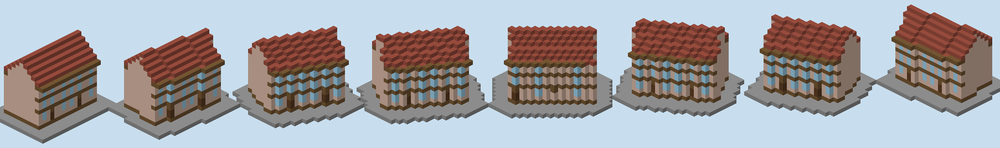

# Emergent City for Minecraft Forge 1.20.1

Run one command and villagers grow a historic-style town out of the terrain around you. It follows the rules in
*Emergent Historic City Generation v1.0*:
- streets, blocks, plazas, centres and monuments come out of the growth simulation;
- the simulation reads the actual ground, water and slopes of your world;
- the houses along the streets are built from **house units**: designs stored as ordinary structure files, which you can
  open, edit and add to with a structure block (see *House units*).

## Setup

1. Download the **Forge 1.20.1 MDK** from files.minecraftforge.net and unzip it.
2. Copy this project over it, replacing `src/`, `build.gradle`, `settings.gradle` and `gradle.properties`.
   Keep the MDK's `gradlew`, `gradlew.bat` and `gradle/` folder.
3. If your MDK uses a different 47.x Forge build, edit `forge_version` in `gradle.properties` to match.
4. Test with `./gradlew runClient`, or build the jar with `./gradlew build` (it lands in `build/libs/`).

## Test world type

For trying out city generation, the mod adds a world type, **City Test (gentle hills, no trees)**. Pick it on the *World Type* button under *More World Options* when you create a world. It has:
- gentle rolling grassland around y 65–95, with no caves, cliffs or overhangs, and a few shallow lakes in the low spots;
- one grassy biome with no trees, no villages or other structures, and no mob spawning.

The Nether and the End are vanilla. The type is made of data files only (`src/main/resources/data/`), with no code.

## Commands (op level 2)

| Command | What it does |
|---|---|
| `/emergentcity generate <radius> [options]` | **Villager mode.** Villagers grow and build a town around you, live (about 10–20 minutes for radius 200). |
| `/emergentcity instant <radius> [seed] [grand] [bricks] [boulevards]` | Plan and place the whole city at once. |
| `/emergentcity evolve [radius] [maintain] [insane]` | Bring the last finished villager town back to life (if it hasn't been undone). The radius limits where evolution may change things. |
| `/emergentcity stop` | End evolution. The masons finish the job in hand, then the crew is released. |
| `/emergentcity status` | Show progress |
| `/emergentcity cancel` | Stop immediately. The villagers are released; what was built can still be undone. |
| `/emergentcity undo` | Restore the world for the last city, including everything an evolving town changed, and remove its villagers. The last 5 are kept until the server stops. |
| `/emergentcity units` | Reload the house units (built-in and your own) and list how many there are per angle |
| `/emergentcity reloadconfig` | Re-read `config/emergentcity.properties` (and the house units) |

Options for `generate` go after the radius, in any order:

| Option | Effect |
|---|---|
| a number, e.g. `42` | The seed, to reproduce a town. Without it a random seed is chosen and printed. |
| `boulevards` | Lay out wide, **dead-straight boulevards** (14 blocks wide) from the main square before the rest of the town grows. `boulevards` gives one avenue straight through the centre; `boulevards=1` to `boulevards=4` sets how many arms (4 = a cross). They follow the gentlest dry direction and keep their heading, sidestepping obstacles by a few degrees at most. Side streets leave them at right angles one block apart. The boulevards **converge on the main square and its cathedral**, and each one ends, about 60% of the way to the edge (`growth.boulevardReach`), in a **square of its own with a civic or market hall**, placed where possible straight ahead so it closes the view down the boulevard. Evolution never removes them. |
| `bricks` | Brick facades in several tones (red, tan, granite, grey, dark brick, varying house to house) with **red nether brick roofs**. Same as `palette=redbrick`. |
| `palette=<name>` | Town palette: `warm` (default), `redbrick`, `brick`, `whitewash` or `stone`. |
| `freestanding` | **Free-standing monuments:** each monument stands on its own in the middle of its square instead of on the edge of a block. The main square gets the cathedral; other centres get, in turn, a **forum**, a **colosseum**, a **church**, a civic hall or a market hall. Each square grows to stay in proportion (about 1.6× the monument plus a margin all round, `plaza.freeFactor`) by merging neighbouring blocks into it and removing the streets between them; built blocks, monument blocks, boulevards and the main approach roads are never merged away. The deliberately generous square is ringed with large trees for scale, and the fountain and bell stand in front of the monument. Off unless you ask; works with `instant` too. |
| `grand` | Build one **oversized landmark**: a grand cathedral, about 1.5× an ordinary one (`landmark.grandScale`), with a square sized to match. Off unless you ask. If no plaza frontage is large enough, it steps down in size and chat tells you an ordinary cathedral was built. |
| `evolve` | After the town is complete, a crew keeps developing it (see *Evolving towns*). |
| `er=<blocks>` (or `evolveradius=<blocks>`) | The radius within which evolution operates. Implies `evolve`. It can be smaller than the town (only the centre keeps changing) or larger (the town may grow outwards). The terrain is read out to the larger of the two radii. |
| `insane` | **Insane evolution** (implies `evolve`): the crew ignores the storey cap and keeps building taller, mostly raising the tallest, most important buildings a storey or two at a time, until they reach the top of the world. Also works as `/emergentcity evolve insane`. |
| `storeys=<n>` | The most storeys a house may have (1–30; default automatic, 4). Above 4, the whole town scales up so the centre reaches the limit. Works with `instant` too. |
| `units=off` | Draw every house from scratch, as before the unit library. Works with `instant` too. |
| `maintain` | Masons put back house blocks that players break, while the crew is in town (see *Block maintenance*). |

Examples: `/emergentcity generate 200`, `/emergentcity generate 200 bricks boulevards`, `/emergentcity generate 200 42 grand`, `/emergentcity generate 200 evolve er=260 maintain`, `/emergentcity instant 250 7 grand`.

## House units

Street-side houses are assembled from **units**: designs saved as vanilla structure files (`.nbt`, the format a structure block saves).

**Pieces.** Each unit is a stack of pieces, each its own structure file:
- `ground`: the ground floor of a home;
- `shop`: the ground floor of a shop, restaurant or bookstore;
- `upper`: one upper storey, repeated as many times as the house has storeys;
- `roof`: the roof, starting on the row above the top storey.

Files are named `<unit>_<piece>`, for example `w7d9a2_ground`. Several files for the same piece, such as `w7d9a2_upper_2`, are variants; each house picks one.

**Angles.** Each design is drawn for one angle. The starting set has a separate design for every 11.25° (0°, 11.25°, 22.5° and so on up to 78.75°). The town only turns designs in quarter turns, so a street at 30° uses the 33.75° design, not a rotated square house. (12.25° doesn't divide a right angle evenly, so 11.25° steps are used.)

**Starting set.** It is generated in code by `UnitDesigner`:
- widths 5–10 and depths 7–9 at each of the 8 angles;
- 144 units, 576 files, in `src/main/resources/data/emergentcity/structures/units/`.

The party walls of a design run exactly along its angle. The right wall of one unit and the left wall of the next are therefore the same cells.

**Plots sized to units.** Along each street side of a block, units are chained party wall to party wall: each unit starts on the previous unit's end point.
- At each step the town picks, from the designs within 8° of the street's angle (`units.maxAngleError`) and as deep as the plot, the one that keeps the row on the street line and brings it out evenly at the far corner.
- Corners, infill, gateway houses and anything a design can't fit are still drawn from scratch.
- The gap at the end of a row is closed by the corner house or a narrow infill house.

**Shared walls.** Neighbouring houses share one wall instead of standing two walls back to back.
- **Chained units** share their party-wall column; the taller unit owns it.
- **Other houses** leave their own wall out wherever a neighbour's wall already stands, and their floors run up to it.
- **Different heights:** where one house is taller, the taller one's wall continues above the lower roof.
- **Evolving towns:** a wall a standing neighbour leans on stays up when the house that built it is demolished or rebuilt.

In tests, 96–98% of party-wall columns are a single shared wall. The rest are where three houses meet, or rows at different angles.

**Placeholder blocks** take on the town's palette, so one design works in every palette:

| Block in the design | Becomes |
|---|---|
| white wool | facade wall |
| gray wool | ground-floor rustication (on grand facades; wall otherwise) |
| light gray wool | trim (eaves, lintels) |
| cyan wool | string course (trim on grand houses, wall otherwise) |
| black wool | pilaster (on facades that have them) |
| brown wool | floor planks |
| purple wool | painted accent wood (shopfronts) |
| iron door | the house's door (painted for shops) |
| waxed cut copper block / stairs / slab | roof |
| waxed exposed cut copper stairs | cornice |

Every other block (glass, beds, barrels, ladders, lanterns, stone, anything) is placed as it is. Air is never placed: the plot is cleared first.

**Designing your own units:**
1. Load a built-in design in a structure block (LOAD mode, name e.g. `emergentcity:units/w7d9a0_ground`). The built-in files are also ordinary datapack structures.
2. Build or edit.
3. Save it with a structure block (SAVE mode) under `emergentcity:units/<name>_ground`, `_shop`, `_upper` and `_roof`.
   - Saving under a built-in name replaces that design.
   - Saved files land in the world's `generated/emergentcity/structures/units/` folder. Files in `config/emergentcity/units/` are read too.
4. Run `/emergentcity units`.

**Frame markers.** The ground piece needs structure blocks in **DATA** mode as markers, on the bottom layer:
- `origin`: the front-left corner, on the party wall;
- `next`: the front-right corner, where the next unit's origin goes (the shared party wall);
- optionally `rear`: the rear-left corner.

The direction from origin to next sets the unit's angle and width. The house lies to the right of that direction (seen from above, origin to next pointing east, the house extends south and its front faces north onto the street).

The other pieces line up with the ground piece when saved with the same X/Z offset and size, or with their own `origin` marker. Each piece's height is one storey (the bottom layer is its floor). The footprint is the bottom layer of the ground piece.

## Villager mode

The villagers *are* the agents of the simulation.

- **Surveyors (cartographers).** Each surveyor is responsible for the growing end of a street:
  1. It walks there along existing streets.
  2. It re-reads the terrain around where it stands (so player changes count).
  3. It makes the growth decision on the spot, using the same proposals, constraints and costs as the simulation (contours, junction angles, block sizes, vistas, attraction to centres).
  4. It walks the new segment while the street is paved just behind it.

  Branches recruit new surveyors, up to 12.
- **The town takes stock between growth phases.** In the background it re-evaluates traffic, street hierarchy, centres, plazas and block subdivision; the villagers keep working meanwhile. Newly settled blocks go into a work queue.
- **Masons** (up to 16) take the nearest job:
  - paving and planting a block;
  - building a house bottom-up, floor by floor;
  - paving a new plaza;
  - one quarter of a monument.
- **Finished buildings are obstacles.** Later streets must route around them, so the town keeps its history.
- **When the town is complete,** the villagers are released as ordinary townsfolk. Every house has a bed, some have job blocks, and the main square has a bell, so the village works normally afterwards.

A bar at the top of the screen shows the phase and how many houses are built; chat reports each phase.
Villager-mode settings are the `mc.live.*` keys in the config (numbers of surveyors and masons, walking speed, build rates, how far a surveyor looks around).

## Evolving towns

With `evolve`, the finished town is handed to a crew (2 surveyors and 4 masons by default; everyone else becomes ordinary townsfolk).
Evolution is optional: without it, towns are built exactly as before and then left alone.

Every town review (60 s by default) the crew re-runs the town's analysis (traffic, centres, plazas, building tiers) and makes a few changes, all inside the evolution radius:
- **Buildings.**
  - **raise:** an important, well-placed house gains a storey, within the height cap;
  - **renew:** an old house is rebuilt with a new facade;
  - **convert:** a house changes use (home, shop, mixed-use, bookstore, restaurant) and its ground floor and interior follow;
  - **merge / split:** two narrow neighbours become one house, or a wide house becomes two;
  - **clear:** a modest house is demolished and its lot becomes a garden; vacant lots are **rebuilt** a few reviews later;
  - **redevelop:** most of a block is cleared and re-planned with a new layout, sometimes with a new street through it.
- **Streets.** Streets are extended, new ones are cut, little-used dead ends are removed (the paving goes back to ground), and streets whose traffic changed are re-laid narrower or wider.
- **Plazas.** Plazas grow, shrink, move with their centre, or dissolve when the centre fades.

Changes are **staged**: the masons first take down only what the new version doesn't keep, top down, then build only the positions that differ, bottom up. A raised house keeps its walls and gains a storey; a renewed one keeps the blocks its new facade shares. A street block keeps the style and materials it was first built with, so the town stays coherent.
Chat posts a summary every few reviews; the bar at the top shows the current review. Settings are the `mc.evolve.*` keys:
review interval, changes per review, crew size, how often each kind of change happens (`mc.evolve.weights`), and an optional time limit.

## Block maintenance (optional)

With `maintain`, a mason replaces a block of a finished house that a player breaks, about 30 s later (`mc.maintain.delaySeconds`). It only works while villagers are working on the town (building or evolving), since they do the repair.
- **Removing a block on purpose:** break it while sneaking, and it is never put back.
- **Each position is repaired once.** If you break a repaired block again, the town accepts the change.
- Only house blocks are maintained, not streets, gardens or monuments. If evolution rebuilds the house meanwhile, the new building wins.

## Progress and results

- **Progress bar.** A bar at the top of the screen shows the current stage and percentage while the city generates.
- **Chat panel.** Chat shows the three stages (read terrain, grow the city, place blocks), ticking each off with its stats, plus progress bars at 25/50/75%.
- **Final summary.** When the city is done, chat lists where it starts (north-west corner) and ends (south-east corner), its extent in blocks, and the main square and monuments. Click any coordinate to put a `/tp` command in your chat box.

## How the spec maps to blocks

One block is one metre.
- **Streets:** paving by class.
  - local: cobble mix;
  - connector: stone bricks;
  - primary: polished andesite with stone-brick edges.

  Streets follow a graded line between junction heights, cutting and filling the ground as needed.
- **Lighting:** glowstone lamp posts (dark oak posts) every 12 blocks along streets (`mc.lampSpacing`), alternating sides, plus a ring around each plaza. Shopfronts have a glowstone wall lamp.
- **Squares (plazas):** a square is a block the town leaves open beside one of its centres, not a shape drawn at a junction. At each centre the town picks one of the blocks touching the centre's junction: about 1,200 m² (`plaza.blockTarget`), larger for the cathedral's square (about 1.7× the cathedral's width across), compact, dry, and not already built on. It keeps that block from then on. Busy junctions elsewhere may take a small adjoining block, often a leftover wedge, as a little square. Monuments stand on the neighbouring blocks, facing the square across the street. Streets may run along a square's edges but never across it. The paving slopes gently between the levels of the junctions around it instead of being forced flat. Central squares get a fountain and bell in the middle and a ring of lamps. Until a suitable block has closed (early on, or at the town's edge), a centre has a small round square at its junction.
- **Houses:** unit houses come from their designs (see *House units*). Corner, infill and gateway houses, and any plot no design fits, are drawn from scratch: each 4-corner footprint is filled as a polygon. Each house gets:
  - walls, and floors every storey, with a ladder up to every storey;
  - tall, narrow **canal-house windows** of full glass blocks (2 blocks high, with lintel and sill trim), one per bay, also on the side street for corner houses;
  - **entrances:** every shop, restaurant and bookstore has its door flanked by painted wood posts (dark oak, spruce, mangrove, crimson or warped) with a matching door and a sign band over it, and single shop windows rather than a glass front. About 30% of homes get a painted-wood doorway too (`use.accentDoorShare`);
  - a front door, and a **rear door into the courtyard** with a path to the garden. On slopes the courtyard is terraced to the house's floor level;
  - on richer facades: string courses, pilasters, a cornice overhanging the street, and balconies for tier 2;
  - a pitched roof in the town's palette.
- **Uses and interiors:**
  - **homes:** beds, a table, storage;
  - **shops** (mixed-use): a counter at street level, rooms above. Most corner and infill buildings on main streets are shops, since they often have no door to the courtyard (`use.cornerShopShare`);
  - **where businesses go:** shops, bookstores and restaurants only on main streets and plazas (`use.minStreetClass`, default 3 = main street); lanes and connecting streets are homes. In an evolving town, a business left on a street that is no longer a main street is turned back into a home;
  - **bookstores:** shelves and reading tables, near the centre on busier streets;
  - **restaurants:** tables inside, and outdoor tables and chairs on the plaza or main street in front, leaving a lane free.
- **Height rules:** the floor sits at the street level in front of the door. Building heights still come from the street-width ratio (about 1:1).
- **Monuments:**
  - The cathedral faces its square across the street; its square is chosen in proportion to it.
  - The cathedral has a portico of quartz columns, a pitched nave, a copper dome on a drum, two towers with spires and stained-glass windows. Its total height is at least its width. If the plaza frontage is short, it shrinks (to no less than 70%) rather than not being built.
  - Civic and market halls have a courtyard, a ground-floor arcade and a tower.
  - With `freestanding`, three more types: a **church** (a nave with tall windows and one tower with a spire over the door), a **forum** (a colonnaded portico round an open paved court, with a temple on a podium at the far end) and a **colosseum** (an oval of three tiers of arches round tiered seating and a sand arena, with gates at either end of its long axis).
- **Paving and green space:** the whole city footprint (every street-bounded area) is paved first. Green space is then carved into block interiors: the shared rear gardens, and small parks with a paved edge in blocks without houses. Gardens get grass, flowers, bushes and small trees.
- **Even heights per block:** every house along a block's streets takes the block's typical storey count, so each block has one cornice line. Variation goes to the corners: about half of them rise a storey above the row (or, rarely, drop one below). In an evolving town, raises go to corners or to houses below their row's height, so the cornice line stays even.
- **Buildings before gates:** along the street, the houses beside a gap widen into it (up to 9 blocks, `block.gapFillFront`), so most gaps become building.
- **Hofje walls:** if a stretch of a built block's street edge is still open after that (a gap that would show the courtyard), it gets a garden wall along the street in the block's own wall material, capped with its trim, with a door in the middle into the courtyard, like the gate of a Dutch hofje (`block.gateWalls`). With these, 99.6–100% of street edges are closed in tests.
- **Facades face the street:** the front of every house is on its street. Any other wall that faces a street, plaza or paving (side walls at the end of a row, corner and infill sides) gets windows at a regular rhythm, so streets don't show blank walls.
- **Block size and courtyards:** every block is deep enough for two rows of houses and a courtyard. A street may not run alongside another street closer than 19 blocks of buildable depth plus half of each street's width (`growth.minBlockDepth`), so side streets keep their distance from boulevards and main streets, and no block is a single row of houses. Streets meet and branch at near-right angles with gentle bends, so blocks are regular rather than wedges. Growth avoids closing very small loops and cuts large blocks with a new street. In tests, single-row blocks went from 12–28% to 0–7%, and nearly every block keeps a planted courtyard with room for villagers to walk around.
- **Closed street walls:** after the plots are laid out, a gap-filling pass walks each block's outline and builds infill wherever a stretch is still open (wedges, collapsed corners, rejected plots): rectangular infill buildings along the street, near-square corner buildings, and narrow "flatiron" buildings across sharp corners. In tests about 98% of street edges have a building in front of them (it was about 70%). Every plot on a block's edge is built. Corner wedges and plots too small to build are absorbed by the neighbouring house, so the facades along each street are continuous. Long blocks get a gateway house with an archway through its ground floor into the garden.
- **Existing buildings are kept.** Before growing, the town marks man-made blocks already in the world (planks, bricks, glass, stone bricks and so on, e.g. a vanilla village) and grows around them (`mc.preserveStructures`).

Minecraft scale (applied automatically from the radius):
- streets: lanes 3–3.5 blocks (most side streets 3 wide), connectors 4–6, main streets 6–9, civic axes 8–11, boulevards 14 (up to 30% wider for large radii);
- plots: near-square, about 7–9 blocks deep and wide, so every house has a walkable interior (at least 2×2, typically 5×6);
- corners: one or two near-square corner houses fronting both streets; corners sharper than 70° stay open as a small paved square;
- heights: storeys of 3 blocks (4 on the ground floor), at most 4 storeys (about 13 blocks plus the roof), and never taller than 1.9× the house's frontage;
- monuments: cathedral 17–24 wide and about twice as deep (1.5× with `grand`).

**Palette.** One named palette per town (`mc.palette`):
- `warm` (default): sandstone classical core, pale plaster with timber trim outside, red tile roofs;
- `redbrick` (or the `bricks` command option): brick facades that vary from house to house (mostly red brick, with tan mud brick, granite, grey and dark brick), stone trim, red nether brick roofs;
- `brick`, `whitewash`, `stone`: alternatives with slate roofs.

Each district uses one wall material. Every house gets the same pitched roof, windows and doors. Important buildings stand out through trim, cornices and pilasters rather than colour. Monuments keep their own white stone. `mc.paletteVariation` (default 0) lets a share of street blocks use a close alternate tone.

All settings live in `config/emergentcity.properties`. The file is written on first use with every line commented out (`#`), so nothing is overridden until you remove a `#`.
If you ran an earlier version, it is safest to delete that file (in `run/config/` when using `runClient`) so the new one is written.
The `mc.*` keys control Minecraft behaviour. With `mc.scaleToRadius=true`, some settings are derived
from the radius (growth radius, budget, street widths, centre spacing). Any key you set explicitly in the
file overrides the derived value.

## What has and hasn't been verified

- **Verified here** (in a fake world, see *Developer tools*):
  - Every mode (instant, villager, evolving) on four test terrains: plains, rolling hills, a steep mountain and a river valley.
  - **Building integrity:** every block each house was meant to have is checked against the world. Instant and villager towns: 0–8 wrong blocks out of 100,000–500,000. After 20–30 minutes of evolution: about 0.003%, mostly single air gaps.
  - **Courtyards:** 93–98% of rear doors reach their garden on flat or rolling ground, 83–93% on the mountain.
  - **Existing structures:** 6 pre-placed huts: 0 of 588 blocks changed in every run.
  - **Maintenance:** 60 broken blocks: all 40 normal breaks repaired, all 20 sneak-breaks left removed, all 40 second breaks left removed.
  - **Undo** restored every changed position exactly, and every villager was removed.
  - **Party walls:** 96–98% of the columns between neighbouring houses are a single shared wall (about 95% before, counting only plain houses), with no openings between houses.
  - **Units:** 35–60% of houses are unit houses; the structure files written by `UnitDesigner` are read back by the mod's own reader.
  - The Minecraft-side code compiles against stand-ins for the Forge and Minecraft classes it uses.
- **Not verified:** the real Forge build and an actual game session. The stand-ins encode my understanding of the 1.20.1 mappings (official names). If a name or signature differs, `gradlew build` will point at it; send me the error.

## Developer tools

`devtools/fakeworld/` holds the fake-world test bench (not part of the mod):
- `mkstubs.py` writes minimal stand-ins for the Minecraft and Forge classes the mod uses;
- `harness/Harness.java` runs a town in a simulated world and reports integrity, courtyards, lighting, preserved structures, maintenance and undo, and renders top-down and isometric PNGs;
- `UnitDesigner` (in the mod) writes the starting set of unit structure files: `java ... com.emergentcity.city.UnitDesigner <dir>`;
- `harness/UnitGallery.java` renders unit designs side by side (`preview_units.png`);
- `run.sh` compiles everything (`RESTUB=1` regenerates the stand-ins). Usage: `java ... Harness <plains|hills|steep|valley> <radius> <seed> <instant|live|evolve:MIN[:RADIUS]> <outPrefix> [key=value] [huts=N] [breaks=N]`.

## Known limitations

- **Simplified placement.** Blocks are placed without neighbour updates (flags 2|16) to avoid lag and chain reactions. Stair, door, ladder and bed states are set directly, but fences won't auto-connect (lamp posts and table legs are single posts, so this rarely shows).
- **Undo is partial.** It restores blocks, not the contents of chests or other block entities that were in the way. Undo history is lost when the server stops.
- **Terrain.** On steep ground, streets become stepped ramps. Where neighbouring terraces are two or more blocks apart, about 10–15% of courtyard doors open onto a step too high to walk, and about 3–5% of houses facing a garden get no rear door (no suitable wall).
- **Grand landmark.** It needs a long plaza frontage, which the emergent street network often doesn't offer. It then steps down in size and you are told. The ordinary cathedral may also be smaller than 17 wide on cramped sites.
- **Evolution.** After long runs a few dozen single blocks (out of hundreds of thousands) can be missing where demolitions and street re-lays meet. Evolution can't reach beyond the area read when the town was founded; give `er=` at `generate` to enlarge it.
- **Maintenance** covers house blocks only, only while villagers are working on the town, and is not saved across server restarts.
- **Performance.** Most ticks stay within the 25 ms budget, but a phase review can occasionally cause a tick of 100–250 ms.
- **Bridges.** Supported (a stone deck with rails) but rarely chosen with default settings.
- **Units.** Designs exist for 8 angles, so a unit row follows a street within a few degrees and the facade line can step by a block where units of different widths meet. Rows meeting at a corner, or units of different angles side by side, may keep two walls back to back for a few cells. The structure files are read by the mod's own reader rather than the game's structure manager; entities saved in a design are ignored.
- **Not built yet:** chimneys, and placement in other dimensions (only the overworld has been considered).
